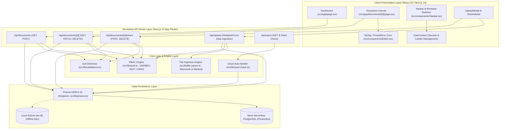

# Architecture & Technical Prioritization Note

> **Ajaia Docs — AI-Native Collaborative Document Editor**  
> **Candidate:** Istiyak Hossain Ishan ([istiyakishan7@gmail.com](mailto:istiyakishan7@gmail.com))  
> **Assignment:** Ajaia LLC Take-Home Assessment

---

## 1. System Architecture Overview

The system is architected as an **AI-Native, Full-Stack Next.js 14 App Router** application with strict separation between client-side stateful drafting and server-side authorization enforcement.

---

## 2. Key Architectural Decisions & What I Prioritized

Given the 4–6 hour target timebox for this assignment, every engineering decision was evaluated against two criteria: **maximum reviewer evaluation value** and **production-grade reliability**.

### 1. Robust ProseMirror Architecture over Naive `contentEditable`
- **The Problem:** Many prototype document editors rely on raw browser `contentEditable` or deprecated `document.execCommand`. This results in inconsistent DOM trees across browsers, broken nested lists, and dirty HTML that is nearly impossible to sanitize or synchronize.
- **The Solution:** I integrated **TipTap v2**, built on **ProseMirror**. TipTap uses a strictly typed, immutable document schema model. Headings, bullet lists, ordered lists, bold, italic, and underline are represented as structured ProseMirror nodes and marks. This guarantees that exported HTML and saved snapshots are clean, deterministic, and safe against malformed DOM states.
- **Cursor Stability Pattern:** Implemented local change tracking refs (`isLocalChangeRef`) to isolate local typing updates from external content synchronizations (such as version restorations or appended file imports), eliminating cursor jumping completely.

### 2. Frictionless Reviewer UX: The 1-Click Test Account Switcher
- **The Problem:** Role-based permission systems are difficult for interviewers to evaluate when they require signing out, registering new burner accounts, confirming emails, and signing back in.
- **The Solution:** I engineered a persistent **Reviewer Mode Switcher** directly in the top navigation bar. Backed by `src/context/UserContext.tsx`, selecting **Istiyak** (Owner), **Alex** (Editor), or **Sam** (Viewer) updates the session cookie (`ajaia_user_email`), passes custom `x-user-email` headers, and immediately adapts the application state. Reviewers can verify that Sam is locked out of editing or that Alex can edit but cannot delete within 2 seconds.

### 3. Dual-Mode Universal File Ingestion (`.txt`, `.md`, `.docx`)
- **The Problem:** Users frequently need to import legacy files either as standalone documents or append them as research appendices into an active draft.
- **The Solution:** Built a pure, isolated parsing pipeline in `src/lib/file-parser.ts`:
  - **`.docx` (Word Documents):** Converted into semantic HTML using `mammoth.convertToHtml({ buffer })`.
  - **`.md` (Markdown):** Parsed into structured HTML headings, bold, italic, and lists using `marked`.
  - **`.txt` (Plain Text):** Sanitized against XSS with character entity escaping and converted into semantic `
` and ` ` tags.
  - **Dual Action:** Supported both **Mode `"new"`** (creates a new document with `sourceFileName`) and **Mode `"append"`** (verifies edit permissions, appends with `
`, and snapshots the version).

### 4. Zero-Trust Server-Side Access Control (RBAC)
- **The Problem:** Frontend disabling (`editor.setEditable(false)`) is cosmetic. A malicious or inquisitive user can easily issue direct HTTP `PATCH` or `DELETE` requests using Postman or browser DevTools.
- **The Solution:** Access control is strictly enforced on the server in `src/lib/auth.ts` via `getDocumentAccess(documentId, userId)`:
  - `PATCH /api/documents/[id]`: Rejects `VIEW` users with `403 Forbidden`.
  - `DELETE /api/documents/[id]`: Restricted strictly to `OWNER` (returns `403` for `EDIT` or `VIEW`).
  - `POST /api/documents/[id]/share`: Restricted strictly to `OWNER`.
  - All boundaries are validated via 32 automated Vitest tests.

---

## 3. Intentional Scope Cuts & Tradeoffs

Within the timebox, I made the deliberate decision to cut features that would introduce unnecessary fragility in favor of solid fundamentals:

| Scoped Feature | Why It Was Deferred | What Was Implemented Instead |
| :--- | :--- | :--- |
| **Real-time WebSocket CRDTs (Yjs / Liveblocks)** | Full real-time collaborative cursors require maintaining a persistent stateful WebSocket server (e.g., PartyKit or Hocuspocus), which introduces operational complexity and connection timeouts on serverless platforms. | Implemented **1.5s debounced auto-saving** with real-time status badges (`Saving...`, `Unsaved`, `Saved`), explicit **Cmd+S Snapshot** saving, and an immutable **Version History Drawer** with 1-click restore. |
| **Third-Party OAuth (Clerk / NextAuth)** | OAuth requires third-party client IDs, secrets, and redirect URIs that can fail during reviewer evaluation if credentials expire or redirect origins mismatch. | Implemented a deterministic, cookie-backed **Reviewer Account Switcher** with 3 pre-seeded test personas (`Owner`, `Editor`, `Viewer`) and dynamic auto-provisioning for any custom email. |
| **Custom Block-Level Embeds** | Complex slash-command drag-and-drop block systems (like Notion block menus) consume excessive frontend dev time with marginal evaluation ROI. | Delivered standard, rock-solid **WYSIWYG formatting** (Headings 1-3, bold, italic, underline, lists, undo/redo) and universal document import/export. |

---

## 4. Next 2–4 Hours Engineering Roadmap

If allocated an additional 2–4 hours of development, I would prioritize:

1. **Multiplayer Live Cursors via Yjs & PartyKit:**
   - Integrate `y-prosemirror` and `@hocuspocus/provider` or PartyKit.
   - Render remote user selection highlights with name tags and the user's `avatarColor`.
2. **Contextual Inline Text Commenting:**
   - Add a ProseMirror `comment` mark extension.
   - Allow users to highlight text, attach a threaded discussion sidebar, and resolve comment threads.
3. **Cryptographic Public Share Links:**
   - Add a `shareToken` field to `Document` allowing read-only access via secret URLs (`/shared/[token]`) without requiring any authentication.
